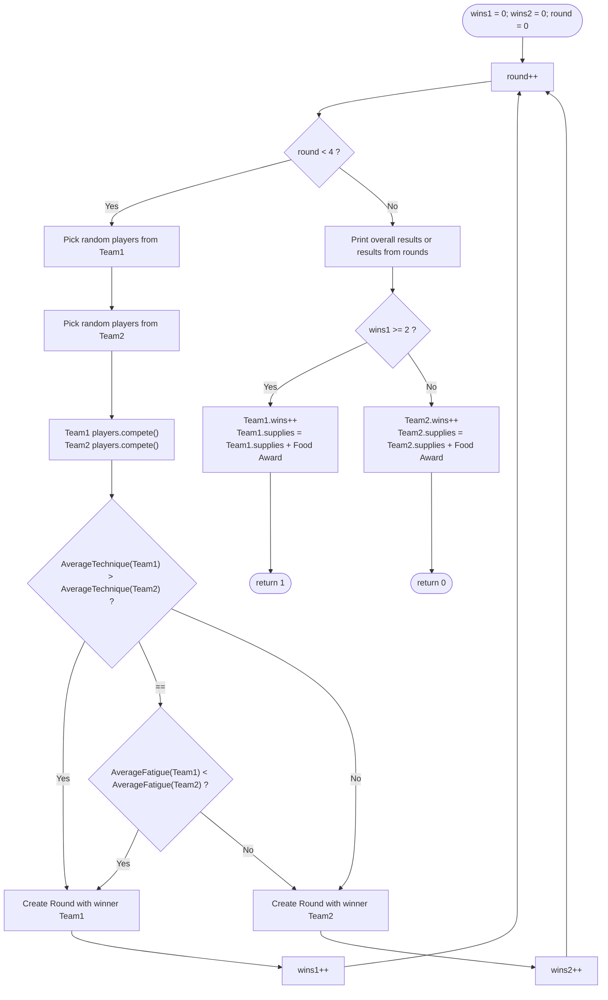
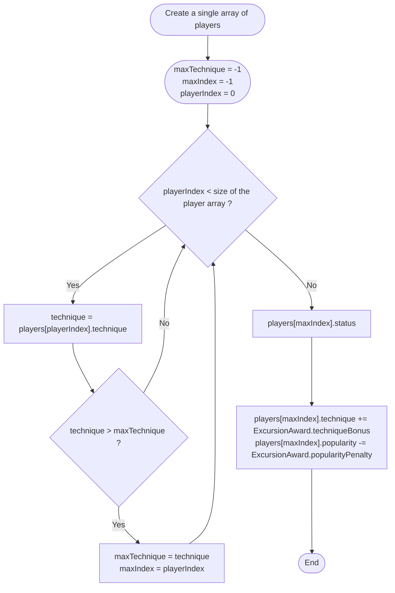
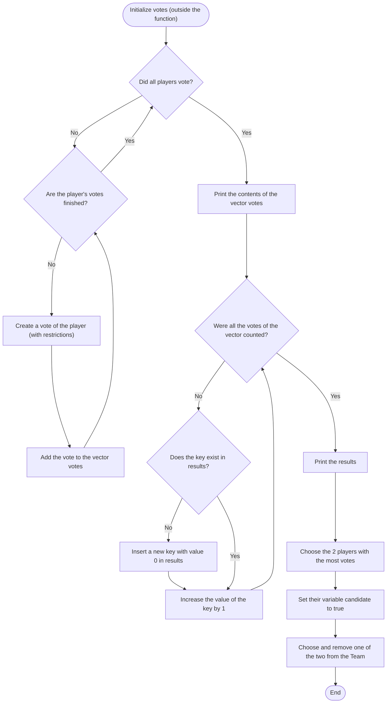

# Master Chef 2018: the assignment briefs for parts C and D

These briefs were issued by the staff of the Object-oriented Programming course (2nd semester, 2018, Department of Electrical and Computer Engineering, Aristotle University of Thessaloniki). Only the English translation is new. The three flowcharts, which were images with Greek labels, are redrawn as diagrams with the same content. Marks, deadlines, the rules for submitting the work and the installation steps of the original are left out.

The code that solves these briefs is in [part-c/](../part-c/) and [part-d/](../part-d/); the reports are [part-c.md](part-c.md) and [part-d.md](part-d.md).

---

# Part C: the competitions

## The game

This year's assignment is a simplified variant of the popular game Master Chef. The aim is to build up, step by step, a program that simulates the game in as realistic a way as possible.

In the third assignment, the task is to implement the classes that will be needed to simulate some of the MasterChef competitions, following the instructions given below. More specifically, you must use the concept of inheritance to implement a base class and three classes derived from it, as well as some parts of main that are needed to complete the implementation.

**ATTENTION!!! You must in no case use the code from your previous assignment to replace the code that is provided ready-made for the third assignment.**

## Description of the game

As we said, every day in the game of MasterChef is a separate day. The 2 teams, the Blue and the Red Team, have many different activities, depending on the day that dawns.

There are five different kinds of day:

1. Normal Day
2. Team Competition Day
3. Immunity Competition Day
4. Creativity Competition Day
5. Voting and Knockout Competition Day (not included in this assignment)

### Normal Day

Every day (each of the kinds mentioned above) starts with the players of the two teams having breakfast and doing the chores the house needs, and ends with the players of the two teams eating and sleeping as a team. Because of the contact they have with the other players, every day also affects their popularity by -10% to 10% (as a percentage, at random for each player).

### Team Competition Day

This day includes the routine of the Normal Day. But in between, at noon, the two teams are taken to a kitchen for the Team Competition.

Every Team Competition consists of 3 separate Rounds. In them 5 (random) players from each team take part, they last 3 hours, and at the end the team whose 5 players have the better technical training on average is declared the winner. If the players of both teams happen to have the same technical training, the winner is the team that is less tired. Every player who competes in a Round of a Team Competition gets tired by 5 - 10% (in absolute value).

The winner of each Team Competition is the team that wins at least 2 of the 3 Rounds. This team receives a Food Award, which contains a number of portions for the team, a random number from 10 - 50 portions.

### Immunity Competition Day

This day includes the routine of the Normal Day. But in between, at noon, the team that lost the Team Competition has to go and compete in the Immunity Competition.

In this competition, which has only one round, the player who has the best combination of technical training (by 75%) and NOT being tired (by 25%) among the players of the team prevails. This player receives the Immunity Award, which gives the player more votes in the Voting and also the status of not being able to be voted for by the teammates.

### Creativity Competition Day

This day includes the routine of the Normal Day. But in between, in the afternoon, the players of both teams are taken to a kitchen to compete in the Creativity Competition.

In the Creativity Competition the player who has the highest technical training compared with the others wins. In this competition, which also has one round, the winner receives an Excursion Award, with which the player increases technical training by 10% and decreases popularity by 10%.

## Part C: implementing base and derived classes

The third part of the assignment requires the creation of the base class Competition and of the three classes derived from it (Team Competition, Immunity Competition, Creativity Competition). Next you must also implement the 4 basic functions that main calls depending on the kind of day that dawns (normalDay(), teamCompetitionDay(), immunityDay(), creativityDay()).

### Implementing the classes

**1. Class Competition (Competition.h and Competition.cpp):**

This class creates the objects/instances of a competition. It includes the following variables:

1. id: an integer (increasing) number, unique for each event.
2. name: a string that contains the name of the event.
3. winner: a string that contains the name of the winner of the event, whether it is a team or a single player.

The functions that must be implemented for this class are at least the following:

a. Initial and final condition functions: 2 initial condition functions must be implemented (one without arguments and one that takes as arguments the code and the name of the event, in this order), whose purpose is to initialise all the variables the class includes. You must match the arguments to the appropriate variables of the class. You must also implement a final condition function.

b. All the get and set functions for all the variables of the class.

c. A function status that prints the values of the variables at that moment.

**2. Class TeamCompetition (TeamCompetition.h and TeamCompetition.cpp):**

This class creates the objects/instances of a Team Competition. It must inherit all the variables of the previous (base) class Competition, but it will also include the following variables:

1. foodAward: an object of type FoodAward (that is, a Food Award).
2. rounds: an array of objects of type Round, which will have 3 positions.

The functions that must be implemented for this class are at least the following:

a. Initial and final condition functions: 2 initial condition functions must be implemented (one without arguments and one that takes as arguments the code and the name of the event, and also the Food Award, in this order), whose purpose is to initialise all the variables the class includes. You must match the arguments to the appropriate variables of the class. You must also implement a final condition function.

b. As many get and set functions for the variables of the class as your implementation needs.

c. A function status that prints the values of the variables at that moment.

d. A function int compete(Team &team1, Team &team2) that takes as arguments references to the two teams that take part in the event and returns a number depending on the team that lost (0 for the Red Team, 1 for the Blue Team). The pseudocode of the implementation you are asked to build follows.

**Team Competition Process (pseudocode of compete in TeamCompetition):**

**3. Class ImmunityCompetition (ImmunityCompetition.h and ImmunityCompetition.cpp):**

This class creates the objects/instances of an Immunity Competition. It must inherit all the variables of the previous (base) class Competition, but it will also include the following variable:

1. immunityAward: an object of type ImmunityAward (that is, an Immunity Award).

The functions that must be implemented for this class are at least the following:

a. Initial and final condition functions: 2 initial condition functions must be implemented (one without arguments and one that takes as arguments the code and the name of the event, and also the Immunity Award, in this order), whose purpose is to initialise all the variables the class includes. You must match the arguments to the appropriate variables of the class. You must also implement a final condition function.

b. As many get and set functions for the variables of the class as your implementation needs.

c. A function status that prints the values of the variables at that moment.

d. A function void compete(Team &team) that takes as argument a reference to the team that takes part in the competition. As we said, the winner is the player who has the best combination of technical training (by 75%) and NOT being tired (by 25%).

**4. Class CreativityCompetition (CreativityCompetition.h and CreativityCompetition.cpp):**

This class creates the objects/instances of a Creativity Competition. It must inherit all the variables of the previous (base) class Competition, but it will also include the following variables:

1. excursionAward: an object of type ExcursionAward (that is, an Excursion Award).
2. ingredients: a static array of strings that will contain the 10 ingredients the players will use. You can put whatever values you want for the cooking ingredients that will be used.

The functions that must be implemented for this class are at least the following:

a. Initial and final condition functions: 2 initial condition functions must be implemented (one without arguments and one that takes as arguments the code and the name of the event, and also the Excursion Award, in this order), whose purpose is to initialise all the variables the class includes. You must match the arguments to the appropriate variables of the class. You must also implement a final condition function.

b. As many get and set functions for the variables of the class as your implementation needs.

c. A function status that prints the values of the variables at that moment.

d. A function void compete(Team &team1, Team &team2) that takes as arguments references to the two teams that take part in the competition. The pseudocode of the implementation you are asked to build follows.

**Creativity Competition Process (pseudocode of compete in CreativityCompetition):**

**5. File main.cpp:**

The functions that must be implemented in the file main.cpp are the following:

1. void normalDay(): implementation of the actions (work and food in the morning; food, conversation and sleep in the evening) carried out by each Team, according to the description above.
2. void teamCompetitionDay(): for the correct implementation of this function you must take the following steps, in the order given:

   a. Each Team works and eats.

   b. Creation of a new FoodAward object.

   c. Creation of a new TeamCompetition object with arguments the id, the name and the Award you have just created.

   d. Call of the function compete of the TeamCompetition object with arguments the two teams, and collection of the output in a global variable of type int.

   e. Each Team eats, socializes and then sleeps.

3. void immunityCompetitionDay(): for the correct implementation of this function you must take the following steps, in the order given:

   a. Each Team works and eats.

   b. Creation of a new ImmunityAward object.

   c. Creation of a new ImmunityCompetition object with arguments the id, the name and the Award you have just created.

   d. Call of the function compete of the ImmunityCompetition object with argument the Team that lost the previous event.

   e. Each Team eats, socializes and then sleeps.

4. void creativityCompetitionDay(): for the correct implementation of this function you must take the following steps, in the order given:

   a. Each Team works and eats.

   b. Creation of a new ExcursionAward object.

   c. Creation of a new CreativityCompetition object with arguments the id, the name and the Award you have just created.

   d. Call of the function compete of the CreativityCompetition object with arguments the two teams.

   e. Each Team eats, socializes and then sleeps.

### Helper classes

Below are presented all the helper classes, with the functions you need in order to implement correctly what the assignment asks for (classes and functions). These have already been implemented by us and you can use them as they are.

**ATTENTION!!! The code of these classes and functions must not be changed.**

**1. Class Team (Team.h and Team.cpp):**

This class includes all the variables and functions that are needed for the implementation of the Team object. The variables of the class Team are the following:

1. string color: the string that denotes the colour of the Team.
2. int wins: an integer that denotes the wins of the Team in the Events. Initial value 0.
3. int supplies: an integer that denotes the number of supplies of the Team. Initial value 14 portions * 11 players.
4. Player *players: an array of objects of type Player that includes the players of the Team.

For each of the above variables the corresponding setters and getters are defined, which you can use as you wish. Apart from these, the functions you can use are the following:

1. void teamWorks(): this function simulates the work of one day by the players of the Team.
2. void teamEats(): this function simulates the consumption of one portion by each one of the players of the Team.
3. void teamSocializes(): this function simulates the socializing and conversation between the players of the Team.
4. void teamSleeps(): this function simulates the process of sleeping for all the members of a team.
5. int getNumberOfPlayers(): a function that returns the number of players in a Team.
6. void status(): a function that prints the values of the variables at that moment.

**2. Class Player (Player.h and Player.cpp):**

This class includes all the variables and functions that are needed for the implementation of the Player object. The variables of the class Player that interest you are the following:

1. string name: the string that denotes the name of the Player.
2. int wins: the wins that a player has achieved individually. Initial value 0.
3. float technique: a decimal number that denotes the technical ability of the Player as a percentage %. Initial value: 20 - 80.
4. float fatigue: a decimal number that denotes the Fatigue of the Player as a percentage %. Initial value 0.
5. float popularity: a decimal number that denotes the popularity of the Player as a percentage %. Initial value 50.

For each of the above variables the corresponding setters and getters are defined, which you can use as you wish. Apart from these, the functions you can use are the following:

1. void compete(): this function simulates the participation of a Player in a Competition (it applies to all kinds of Competitions).
2. void status(): a function that prints the values of the variables at that moment.

**3. Class Round (Round.h):**

This class includes all the variables and functions that are needed for the implementation of the Round object (a separate test within a Competition). The variables of the class Round that interest you are the following:

1. int id: the increasing number of the round (from 1 to 3).
2. int duration: an integer that denotes the duration of the round in seconds.
3. string winner: the string that denotes the name of the Player or Team that won the particular round.

For each of the above variables the corresponding setters and getters are defined, which you can use as you wish. Apart from these, the functions you can use are the following:

1. Round(int id, int duration, string winner): the initial condition function that puts the corresponding arguments into the appropriate variables.
2. void status(): a function that prints the values of the variables at that moment.

**4. Class Award (Award.h) and the derived classes FoodAward (FoodAward.h), CommunicationAward (CommunicationAward.h) and ImmunityAward (Immunity.h):**

This class includes all the variables and functions that are needed for the implementation of the Award object. The variables of the class Award that interest you are the following:

1. string name: the string that denotes the name of the Award.
2. bool solo: a logical variable for whether the Award is individual or not.
3. int bonusSupplies (only in FoodAward): an integer that denotes the supplies the Team wins.
4. int techniqueBonus (only in ExcursionAward): an integer that denotes the increase in technical training the Player wins.
5. int popularityPenalty (only in ExcursionAward): an integer that denotes the decrease in the popularity of the Player who wins the Award.

For each of the above variables the corresponding setters and getters are defined, which you can use as you wish. Apart from these, the functions you can use are the following:

1. FoodAward(string name, bool solo): the initial condition function of the derived class FoodAward, which puts the corresponding arguments into the appropriate variables.
2. ExcursionAward(string name, bool solo): the initial condition function of the derived class ExcursionAward, which puts the corresponding arguments into the appropriate variables.
3. ImmunityAward(string name, bool solo): the initial condition function of the derived class ImmunityAward, which puts the corresponding arguments into the appropriate variables.

**5. File main.cpp:**

This file, part of which you are asked to implement, also includes some global variables that you must use in order to implement your program correctly. These are the following:

1. Team teams[]: the array that contains the two teams that compete. In position 0 is the Red Team and in position 1 is the Blue Team. The data of the Teams and the Players are already filled in by us.
2. int competitionId: an integer variable that can be used to find the code of every new Competition that is created, if you use it correctly.

---

# Part D: voting with dynamic data structures

## The game

This year's assignment is a simplified variant of the popular game Master Chef. The aim is to build up, step by step, a program that simulates the game in as realistic a way as possible.

In the fourth assignment, the task is to implement the classes Voting and Votes, which will be used to simulate the voting that takes place in the Team that lost the Team Competition. More specifically, you must use some dynamic structures found in the C++ Standard Template Library to create the appropriate functions.

**ATTENTION!!! You must in no case use the code from your previous assignment to replace the code that is provided ready-made for the fourth assignment.**

## Description of the game

For the needs of the fourth assignment, the code you are given includes only the part of the program that is needed for the implementation of the voting. More specifically, the process is as follows:

The game is initially on a random day of Master Chef before the first withdrawal. The two Teams are complete in terms of players, and the fatigue, the technical training and the hunger of each player have random values.

What will be simulated in this part of the assignment is the Voting day. When the Voting day starts, the user chooses which of the two Teams lost the Team Competition and will go through the Immunity Event.

The process of the Immunity Event is already implemented and after it ends one player of the Team has won Immunity and also has more votes than the others (2 or 3).

Next comes the process of the Voting for the Team that lost, and also the Withdrawal of one player, which you are asked to implement.

## Part D: implementing dynamic data structures

The fourth part of the assignment requires the creation of the class Voting, as well as of the helper class Vote. A detailed presentation of the classes and of their members, which you are asked to implement, follows.

### Implementing the classes

**1. Class Vote (Vote.h):**

This class creates the objects of type Vote. It includes the following variables:

1. voted: a string that includes the name of the Player who was voted for withdrawal.
2. reason: a string that contains the reason for withdrawal.

The functions that must be implemented for this class are at least the following:

a. Initial condition functions: 2 initial condition functions must be implemented (one without arguments and one that takes as arguments the Player who was voted for withdrawal and the reason for the vote, in this order), whose purpose is to initialise all the variables the class includes. You must match the arguments to the appropriate variables of the class.

b. All the get and set functions for all the variables of the class.

c. A function status that prints the values of the variables at a given moment.

**2. Class Voting (Voting.h and Voting.cpp):**

This class will NOT create objects/instances, since all its attributes will be static. This means that all calls will be made with the name of the class and the scope resolution operator. It will include the following variables:

1. votes: a vector (dynamic array) of objects of type Votes, which will include all the votes that were cast during the Council.
2. results: a map (dynamic structure) that will include the results of the voting. The keys of the map will be the names of the players who were voted for (of type string) and the values will be the votes each of them collected (of type int).

The functions that must be implemented for this class are at least the following:

a. A function static void votingProcess(Team &team) that will include the whole process of the Voting: the casting of the votes, the counting and the extraction of the results. After that, the 2 players who have the most votes must be selected, and the player with the smaller technical training withdraws. You may (and it is suggested that you do) break this function into smaller pieces, as you wish.

**Attention!!!**
1. During the voting, a player cannot vote for himself or herself, for a player who has withdrawn, or for a player who has immunity.
2. The player who has won immunity has more than one vote that must be used.
3. The way in which the players will vote is left to you. You can do whatever you want, from random choices to strategic voting for the best player or for the player with the most wins.
4. If during the counting 2 or more players have the same number of votes, the tie must be resolved in some way by you (keep the first, choose one at random, and so on).

**Voting Process (pseudocode of votingProcess in Voting):**

### Helper classes

Below are presented all the helper classes, with the variables/functions you need in order to implement correctly the classes that are asked for. These have already been implemented by us and you can use them as they are.

**ATTENTION!!! The code of these classes and functions must not be changed.**

**1. Class Team (Team.h and Team.cpp):**

This class includes all the variables and functions that are needed for the implementation of the Team object. The variables of the class Team that interest you are the following:

1. string color: the string that denotes the colour of the Team.
2. Player *players: an array of objects of type Player that includes the players of the Team.

For each of the above variables the corresponding setters and getters are defined, which you can use as you wish. Apart from these, the functions you can use are the following:

1. int getNumberOfPlayers(): a function that returns the number of players in a Team.
2. void setCandidate(string name): a function that changes the variable candidate of a player to true, using the name of the player as input.
3. void removePlayer(int index): this function deletes a specific player from the Team, using the player's position in the array of players of the Team.
4. void status(): a function that prints the values of the variables of the class at that moment.

**2. Class Player (Player.h and Player.cpp):**

This class includes all the variables and functions that are needed for the implementation of the Player object. The variables of the class Player that interest you are the following:

1. string name: the string that denotes the name of the Player.
2. float technique: a decimal number that denotes the technical ability of the Player as a percentage %.
3. float fatigue: a decimal number that denotes the Fatigue of the Player as a percentage %.
4. float popularity: a decimal number that denotes the popularity of the Player as a percentage %.
5. int wins: an integer that denotes the number of wins the player has made in the events.
6. int votes: an integer that shows the number of times this particular player can vote.
7. bool immunity: a variable that shows whether this particular player has immunity or not.
8. bool candidate: a variable that shows whether this particular player is a candidate for withdrawal or not.

For each of the above variables the corresponding setters and getters are defined, which you can use as you wish. Apart from these, the function you can use is the following:

1. void status(): a function that prints the values of the variables at that moment.

**3. File main.cpp:**

This file also includes some global variables that you must use in order to implement your program correctly. These are the following:

1. Team teams[]: the array that contains the two teams that compete. In position 0 is the Red Team and in position 1 is the Blue Team. The data of the Teams and the Players are already filled in by us.
