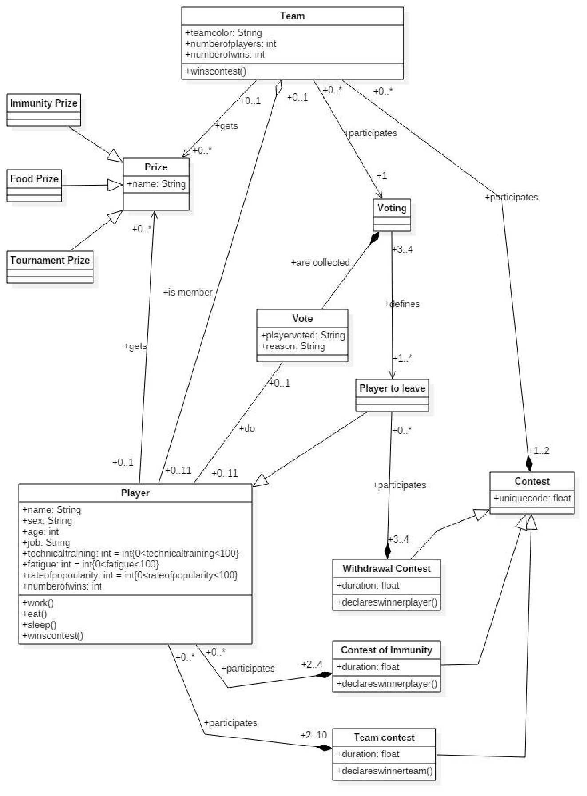

# Master Chef 2018: The Return

Friday, 30 March 2018

Object-oriented Programming, part A: design.

*Figure 1: UML diagram*

## Description of the implementation

### Basic entities, methods and variables

- Players have a name, age, sex, job, and a level of technical training, fatigue and popularity. They also work, eat the food of their teammates and sleep so that they do not feel tired. They can win contests and win prizes.
- Teams, which consist of players, each have their own colour, take part in the contests and win prizes.
- Contests have a code and are divided into team contests, immunity contests and withdrawal contests.
- Prizes have a specific name and are divided into immunity prizes, food prizes and excursion prizes.
- The voting, in which one team takes part and which decides which players will be up for withdrawal.
- The votes, which record the player being voted for, as well as the reason.
- The players up for withdrawal.

### Associations

- The team consists of players, and when the team ceases to exist, the players as entities continue to exist. So the relation that links them is aggregation.
- The team and the players are linked to the contests by the association of composition, because if there are no players and teams, the contest cannot exist.
- The immunity prize, the food prize and the excursion prize are linked to the class prize through generalization, since they are special cases of that class.
- The team contest and the immunity and withdrawal contests are linked to the class contest through generalization, since they are special cases of that class.
- The player up for withdrawal is linked to the player through generalization, and to the withdrawal contest through composition, because if no player were to withdraw, the contest would have no meaning.
- The player has a two-way relation with the vote, since a player has a vote and a vote also records a player.
- The team-prize and player-prize relations are one-way associations.
- Finally, the voting and the vote are linked by composition, since there are no votes without a voting.

### Main multiplicities

- There are clearly 2 teams and the players range from 0 to 11 per team, 22 in total at the start. In particular, the text we were given says that the players who start in each team are 11, so at the start the players who join the 2 teams are 2*11=22! So the multiplicity of the players is 0..11 per team (0..22 in total) and that of the teams is 2.
- In each contest either both teams can take part (team contests) or only one team (withdrawal and immunity contests). A team can take part in anywhere from no contests to many.
- The players who take part in the immunity and withdrawal contests are 2..4, and obviously the immunity contest is 1 and the withdrawal contest is 1.
- The players who take part in the team contests are 2 to 10, since there are 5 from each team.
- In the withdrawal contest 3 to 4 players take part, so that one of them withdraws. So the multiplicity of the players up for withdrawal in the withdrawal contest is 3..4.
- Each player can vote for up to 1 person and receive from 0 up to 11 votes (if they feel like sabotaging themselves).

